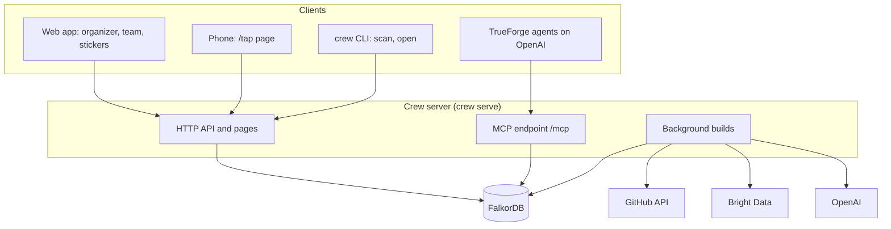

Crew is one Python server in front of one FalkorDB graph. Everything else (the web pages, phones at the door,
TrueForge agents, the `crew` CLI) talks to that server.

## Modules

| Module | Role |
|---|---|
| `crew/graph.py` | FalkorDB access, indexes, turning paths into JSON and readable text, the viewer highlight |
| `crew/web.py` | Bright Data Web Unlocker and SERP calls, a 6-hour disk cache, prompt-injection guard for web text |
| `crew/llm.py` | OpenAI calls for JSON extraction and grounded answers |
| `crew/ingest.py` | Team (GitHub repos → dependencies) and agenda (scrape → extract → graph) ingestion, name normalization, uploads and `scan` |
| `crew/scout.py` | Crew Scout: README topics and goal mapping, with verbatim evidence |
| `crew/planner.py` | The coverage plan and "why" paths |
| `crew/queries.py` | Blind spots, ripple, bridges, stats, read-only Cypher |
| `crew/notes.py` | Notes → extracted packages → fetched sources → ripple on breaking changes |
| `crew/memory.py` | "What did we learn about X?", answered only from notes and their sources |
| `crew/digest.py` | Draft and publish the team digest |
| `crew/tap.py` | NFC check-in |
| `crew/build.py` | Background jobs behind the organizer and team pages, with progress |
| `crew/forge.py` | TrueForge SDK: create agents, run Crew Scout |
| `crew/server.py` | MCP tools, HTTP API and web pages |
| `crew/cli.py` | The `crew` command |

## Design decisions

**Every answer is a path.** Plans, "why", blind spots and ripple come from graph queries and return the path that
justifies them. Model-inferred facts (Scout's README topics) are stored as graph edges with their evidence, so they
show up as a step in a path rather than as an unexplained score.

**Names are the join.** Code and agenda only connect where they share a node, so package and topic names are
normalized on both sides (`norm_pkg`, `ALIASES`, `norm_topic` in `crew/ingest.py`). When the agenda is extracted,
the model is given the team's existing package and topic names to reuse.

**Web content is untrusted.** Scraped pages and READMEs are sanitized and wrapped in `<untrusted_web_content>`
before any model sees them.

**Only dependency names leave a team's code.** Crew never reads or stores source code. See
[Private repos](../guides/private-repos.md).
