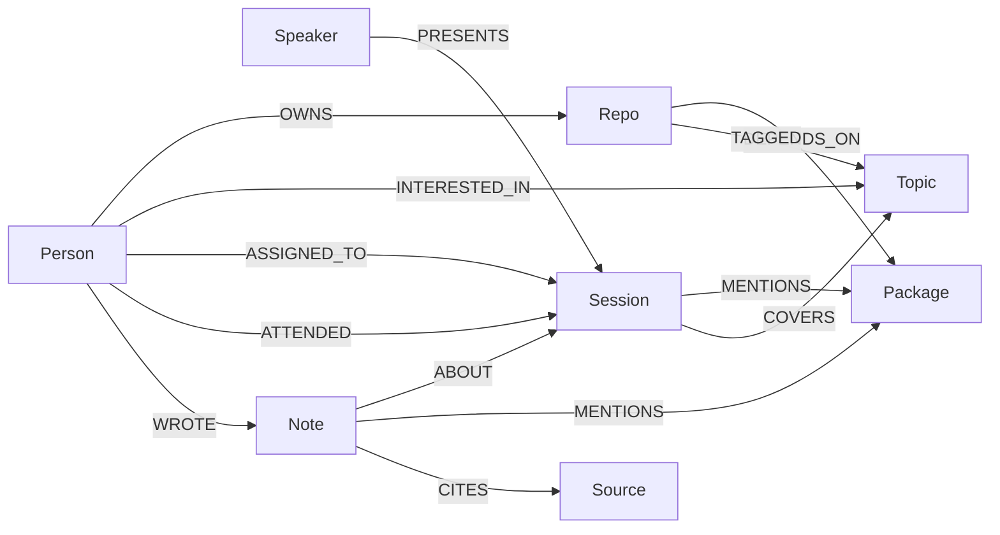

## Three layers

The team's side and the conference's side meet at shared **Package** and **Topic** nodes. A third layer records
what happens at the event.

| Node | Created from |
|---|---|
| `Person` | The team page or `team.json` |
| `Repo` | GitHub, an uploaded dependency file (`local:<handle>/<name>`), or `crew scan` |
| `Package` | Repo dependencies, packages a session or note is about |
| `Topic` | GitHub repo topics, goals, session tags, Crew Scout |
| `Session`, `Speaker` | The agenda |
| `Note`, `Source` | Notes from the floor and the pages Crew fetched for them |

A session about a package also `COVERS` a topic of the same name, so a goal like `github-actions` connects to a
session that only lists GitHub Actions as a package.

## Edge properties that matter

| Edge | Property | Meaning |
|---|---|---|
| `DEPENDS_ON` | `dev: true` | A `package.json` devDependency. Kept for ripple, left out of "not covered at the conference" |
| `TAGGED` | `via: 'readme'`, `evidence` | Added by Crew Scout, with the README sentence that supports it |
| `INTERESTED_IN` | `via: 'scout'`, `evidence` | A goal Scout mapped onto the agenda's topics |
| `ASSIGNED_TO` | `score`, `reason` | The plan |
| `ATTENDED` | `at` | An NFC check-in |

## Bridges

A **bridge** is a Package or Topic with a path to a session from the team's side. Every plan reason passes through
one. The home page and the team build report how many there are.

## How the plan is scored

For each person and session, Crew adds up the evidence paths:

| Evidence | Path | Weight |
|---|---|---|
| Dependency | `Person → Repo → Package ← Session` | 3 |
| Repo topic (GitHub) | `Person → Repo → Topic ← Session` | 2 |
| README topic (Scout) | `Person → Repo → Topic ← Session`, `via: 'readme'` | 1.5 |
| Goal | `Person → Topic ← Session` | 1 |

The planner goes through sessions from most to least valuable to the team and gives each to the free person it
matters most to, avoiding time clashes. Sessions where everyone is busy are reported as missed due to clashes.

## Blind spots and ripple

- **Blind spot:** a session about a package your code depends on with no `ASSIGNED_TO` edge. An empty result means
  every such session has someone in it.
- **Ripple:** start at a package and walk back to repos and owners, plus any notes that mention it.

## Reading the graph view

`/viz` lays the graph out in columns, left to right: people, repos and notes, packages and topics, sessions, speakers
and sources. Boxes never overlap, and long names are cut short (the full name shows on hover and in the side panel).

- **Hover** a box to light it and what it connects to; **click** to pin it and list its connections. Click a row to hop there.
- **Find** matches names; Enter jumps to the first match. **Fit to screen** resets the view.
- The latest answer's path is drawn in purple. Edge names appear only when a handful of edges are lit, so they stay readable.
- Very long columns wrap into side-by-side sub-columns.

:::note Verification
Tested on Oct 24 in a browser against a stand-in for the Crew API (no box overlaps, hover, pin, search, fit, phone and
embedded sizes). Not run against a live `crew serve` with FalkorDB.
:::

