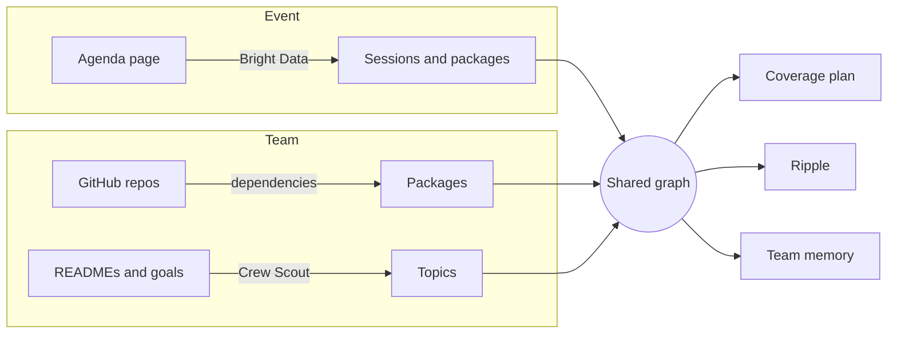

When a team sends a few people to a conference, three things usually go wrong: people pick sessions on their own
and miss the ones that matter to the team's code, what they learn stays in their heads, and the people at home hear
nothing. Crew fixes this with one shared graph that connects the team's code to the agenda.

<CardGroup cols={2}>
  <Card title="Quickstart" icon="rocket" href="/getting-started/quickstart">
    From an empty graph to a coverage plan and a tap check-in in five minutes.
  </Card>
  <Card title="How it works" icon="network" href="/concepts/graph">
    The graph, the bridges between code and agenda, and how the plan is scored.
  </Card>
</CardGroup>

## Every answer is a path

Plans, "why am I here?", blind spots and ripple all come from graph queries, and each answer comes with the path
that justifies it:

```text
dhanush -OWNS-> openai-agents-python -DEPENDS_ON-> mcp <-MENTIONS- Shipping MCP servers to production
```



## Who it's for

<CardGroup cols={2}>
  <Card title="Organizers" icon="calendar" href="/guides/organizer">
    Publish the agenda once and print NFC/QR stickers for every session door.
  </Card>
  <Card title="Teams" icon="users" href="/guides/team">
    Add teammates by GitHub username and watch the graph build, live.
  </Card>
  <Card title="Attendees" icon="nfc" href="/guides/tap">
    Tap the door to check in, see why you're there, and leave a one-line note.
  </Card>
  <Card title="Agents" icon="bot" href="/guides/trueforge">
    One TrueForge agent per teammate, plus Crew Scout, all on OpenAI models.
  </Card>
</CardGroup>

## Reference

<CardGroup cols={3}>
  <Card title="CLI" icon="terminal" href="/reference/cli">Every `crew` command.</Card>
  <Card title="Configuration" icon="settings" href="/reference/configuration">Every setting and file.</Card>
  <Card title="MCP tools" icon="plug" href="/reference/mcp-tools">What agents can call.</Card>
</CardGroup>

:::warning Status
Built for the Patch the Conference hackathon (Oct 24, 2026). Ingestion, planning, blind spots, ripple, check-ins and
the web app are tested against a real FalkorDB and real GitHub repos; notes, team memory, the digest and Crew
Scout are tested against OpenAI, and notes fetch their sources through Bright Data. Live agenda scraping and
TrueForge agents haven't run yet, and their pages say so.
:::
